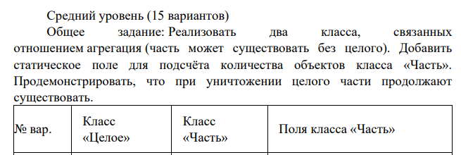
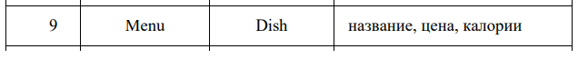
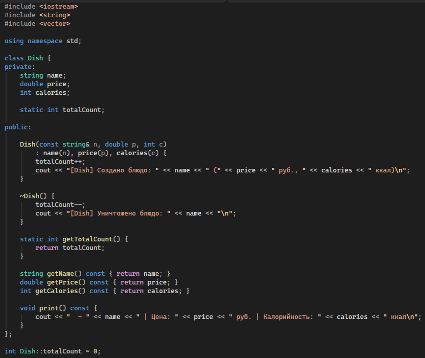
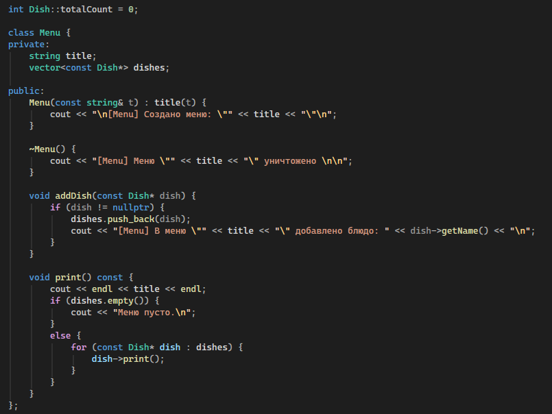
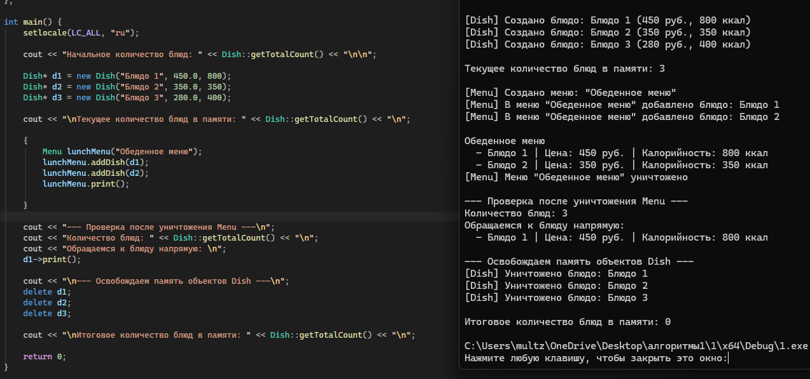

https://github.com/NXGHTMXRE007/alg1

# Лабораторная работа №1: Композиция и агрегация классов. Статические члены »

**Студент:** Евдокимов Иван Александрович
**Группа:** ПИЖ-б-о-25-2(1)
**Вариант:** 9

## Цель работы
1. Научиться проектировать отношения между классами: композицию, агрегацию и ассоциацию 
2. Освоить реализацию композиции (поля-объекты, вложение структур) и агрегации (указатели, ссылки) 
3. Понять разницу между композицией и агрегацией с точки зрения времени жизни объектов 
4. Научиться использовать статические поля и методы для подсчёта объектов и реализации общих данных для всех экземпляров класса 
5. Получить навыки правильного управления памятью при разных типах отношений между классами 

## Выполнение практического  задания

Что такое композиция? Приведите пример.
Это отношение «часть-целое», при котором часть не может существовать без целого, и целое полностью управляет временем жизни части (например, House и Room или Phone и Battery).
Что такое агрегация? Чем она отличается от композиции?
Это отношение «часть-целое», при котором часть может существовать независимо от целого и может входить в состав нескольких целых (например, Menu и Dish или Library и Book).
Как реализовать композицию в C++?
Через вложенные поля-объекты (Room room;) или через умный указатель (std::unique_ptr<Engine> engine), который удаляет объект при вызове деструктора целого.
Как реализовать агрегацию в C++?
Через хранение обычных указателей или ссылок (vector<Dish*> dishes), при этом деструктор целого не удаляет объекты по указателям.
В чём разница между временем жизни частей при композиции и агрегации?
При композиции время жизни части строго ограничено временем жизни целого. При агрегации часть создается до целого или независимо от него и продолжает жить после уничтожения целого.
Что такое статическое поле класса? Чем оно отличается от обычного поля?
Статическое поле принадлежит самому классу, а не отдельным его экземплярам. Память для него выделяется в единственном экземпляре для всех объектов.
Как объявить и определить статическое поле? Где оно хранится?
Объявляется внутри класса с ключевым словом static (static int totalCount;), а определяется вне класса в глобальной области (int Dish::totalCount = 0;). Хранится в сегменте статических/глобальных данных.
Что такое статический метод? Можно ли из него обратиться к нестатическим полям?
Метод класса, вызываемый без создания объекта (Dish::getTotalCount()). Из него нельзя напрямую обращаться к нестатическим полям, так как у него нет указателя this.
Для чего используются статические счётчики объектов?
Для отслеживания количества созданных и находящихся в памяти экземпляров класса в реальном времени.
Что такое паттерн «Одиночка» (Singleton)? Для чего он нужен?
Порождающий паттерн, гарантирующий, что у класса существует только один экземпляр, и предоставляющий глобальную точку доступа к нему.
Как запретить создание копий объекта (конструктор копирования)?
Использовать спецификатор = delete:
 ClassName(const ClassName&) = delete;
ClassName& operator=(const ClassName&) = delete;
В каком порядке вызываются конструкторы и деструкторы при композиции?
Конструкторы вызываются «снаружи внутрь» (сначала составные части, затем само целое). Деструкторы — в обратном порядке (сначала целое, затем его составные части).
Можно ли изменить статическое поле из обычного метода?
Да, обычные методы класса имеют полный доступ ко всем статическим полям.
Почему статические поля нужно определять вне класса?
Потому что объявление в классе только сообщает компилятору о существовании поля, а определение вне класса выделяет под него конкретную ячейку памяти.
В каких случаях стоит использовать композицию, а в каких агрегацию?
Композицию — когда часть является неотъемлемым компонентом целого и не имеет смысла без него (Car и Engine). Агрегацию — когда элементы могут переходить между системами или существовать автономно (Team и Player, Menu и Dish).
